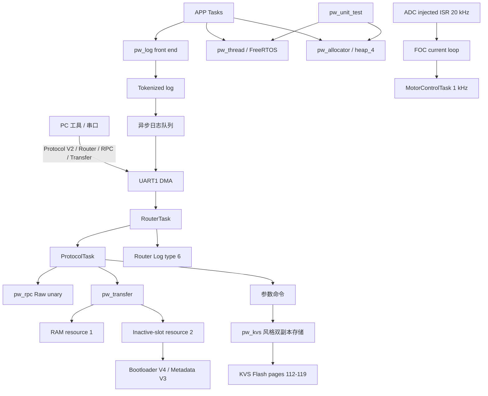

# Stage 5 - STM32G474 Pigweed 移植总结

> [!success] 最终结论
> Stage 5 已完成并通过板上测试。最终版 APP 已分别构建并写入 A、B 两个槽；当前运行槽为 **B**，`CONFIRMED=B`、`PENDING=-`、`ATTEMPTS=0`、`GEN=167`。FOC、Router、IAP 布局和原有实时任务保持不变。

## 1. 项目边界

- MCU：STM32G474RET6
- RTOS：FreeRTOS
- 下载与调试：板载 ST-LINK / SWD
- APP：A/B 双槽，Bootloader V4 + Metadata V3 双副本
- FOC：20 kHz ADC 注入中断电流环
- Router：FreeRTOS 任务，UART DMA 收发，多设备路由
- Stage 5 原则：Pigweed 作为基础设施接入，不侵入 20 kHz FOC ISR，不改变 Flash 布局、DBANK、BFB2、A/B 地址、Metadata 和 SRAM mailbox 地址。

## 2. 最终架构



### 任务与实时优先级原则

- ADC 注入 ISR：只执行确定时长的电流采样和 FOC，不写日志、不动态分配内存。
- MotorControlTask：1 kHz 电机控制。
- TighteningTask：100 Hz 应用状态机。
- RouterTask / ProtocolTask：5 ms 通信处理。
- BootHealthTask：5 秒连续健康门限和 trial 自动确认。
- 日志、RPC、Transfer、测试均运行在线程上下文，不进入硬实时 ISR。

## 3. Stage 5 分步成果

| 阶段 | 完成内容 | 板上验证 |
|---|---|---|
| 5.1 | `pw_assert`、`pw_log` 最小后端，日志复用 UART DMA | 启动日志与断言路径正常 |
| 5.2 | `pw_thread` FreeRTOS 静态线程上下文 | 线程创建、运行、退出计数正常 |
| 5.3 | 轻量 `pw_unit_test` | 5 项测试通过，含 RingBuffer 与 allocator |
| 5.4 | `pw_kvs` 风格参数存储，双副本、CRC、generation | SAVE/LOAD、重启恢复正常 |
| 5.5 | `pw_rpc` Raw unary Ping，channel 1 | ASCII_HEX 适配器请求/应答正常 |
| 5.6 | Transfer V2，RAM 与 inactive-slot 两类资源 | 数据分块、CRC、恢复路径正常 |
| 5.7 | `pw_allocator` 对接 FreeRTOS `heap_4` | 分配/释放后空闲量恢复，ISR 禁止分配 |
| 5.8 | 官方 `pw.transfer.Transfer/Write` 流式写入 | 全量 APP 写入成功，支持重传 |
| 5.9.1 | 异步缓冲日志，级别、历史、drop、dump | 队列和统计命令正常 |
| 5.9.2 | Tokenized log 与 ELF 字典解码 | 3 条 token 日志全部解码 |
| 5.9.3 | Router 多设备日志，订阅、TTL、级别、反向接收 | 本地订阅和远端 type-6 接收通过 |

分阶段细节：

- [[STAGE5_1_PIGWEED]]
- [[STAGE5_2_PW_THREAD]]
- [[STAGE5_3_PW_UNIT_TEST]]
- [[STAGE5_4_PW_KVS]]
- [[STAGE5_5_PW_RPC]]
- [[STAGE5_6_PW_TRANSFER]]
- [[STAGE5_7_PW_ALLOCATOR]]
- [[STAGE5_8_PW_TRANSFER_STREAM]]
- [[STAGE5_9_1_PW_LOG_BUFFER]]
- [[STAGE5_9_2_PW_LOG_TOKENIZED]]
- [[STAGE5_9_3_PW_LOG_ROUTER]]

## 4. A/B 最终同步结果

### 4.1 最终镜像

| 槽 | BIN 大小 | CRC32 | 状态 |
|---|---:|---:|---|
| APP A | 211,924 B | `0x337922CB` | 最终版，曾完成 trial 与 confirm |
| APP B | 211,604 B | `0xDC72910E` | 最终版，当前运行并 confirmed |

> [!note]
> A/B 包含相同的最终功能源码，但二进制大小和 CRC 不要求相同。原因包括链接地址、槽位配置宏以及 tokenized log 中的编译路径令牌。

### 4.2 B 槽同步过程

通过当前 A 的官方 `pw.transfer.Transfer/Write` 接口，把 B 构建写入 inactive B 槽：

```text
FILE=foc2_app_b/build/Debug/foc2.bin
SIZE=211604
CRC32=0xDC72910E
CHUNKS=6613
RETRANSMIT=0
FW END TARGET=B ... COMMIT=BOOTLOADER ATTEMPTS=2 RESETTING
```

启动并完成健康确认后的状态：

```text
CURRENT=B
TARGET=A
CONFIRMED=B
PENDING=-
ATTEMPTS=0
GEN=167
MODE=IDLE
FLT=0
```

## 5. 最终内存占用

最终 clean build 数据：

| 镜像 | Flash 已用 | Flash 总量 | 占用率 | 剩余 Flash | RAM 已用 | RAM 总量 | 占用率 | 剩余 RAM |
|---|---:|---:|---:|---:|---:|---:|---:|---:|
| APP A | 211,924 B | 229,376 B | 92.39% | 17,452 B | 64,576 B | 131,008 B | 49.29% | 66,432 B |
| APP B | 211,604 B | 229,376 B | 92.25% | 17,772 B | 64,560 B | 131,008 B | 49.28% | 66,448 B |

> [!warning]
> APP 槽 Flash 已超过 92%，继续加功能时必须观察 map 文件。RAM 仍有约 65 KiB 余量，但实时系统不能因此放松栈、水位和队列上限检查。

控制体积时采用了：

- 只编译实际使用的 Pigweed 上游源文件，不整体拉入所有模块。
- Pigweed middleware 使用 `-Os`。
- token 字典信息保留在 ELF 供 PC 解码，不进入最终烧录 BIN。
- 固定容量队列和静态上下文优先，避免不可控的代码与 RAM 增长。

## 6. 常用构建命令

在工程根目录执行：

```powershell
cmake --build .\foc2_app_a\build\Debug --clean-first
cmake --build .\foc2_app_b\build\Debug --clean-first
```

查看段大小：

```powershell
arm-none-eabi-size .\foc2_app_a\build\Debug\foc2.elf
arm-none-eabi-size .\foc2_app_b\build\Debug\foc2.elf
```

检查段和符号：

```powershell
arm-none-eabi-objdump -h .\foc2_app_a\build\Debug\foc2.elf
arm-none-eabi-nm --print-size --size-sort .\foc2_app_a\build\Debug\foc2.elf
```

## 7. 固件升级与状态命令

### 7.1 查询当前固件状态

串口发送：

```text
2000 FW STATUS
```

关键判断：

```text
CURRENT=<A|B>
CONFIRMED=<A|B>
PENDING=-
ATTEMPTS=0
```

### 7.2 手动确认 trial APP

仅在新 APP 已完整启动且健康后发送：

```text
2001 FW CONFIRM
```

正常情况下 BootHealthTask 满足 5 秒连续健康门限后也会自动确认。

### 7.3 官方 Transfer 写入 inactive slot

```powershell
.\tools\transfer_iap_stream.ps1 `
  -Port COM5 `
  -Image .\foc2_app_b\build\Debug\foc2.bin
```

升级成功必须同时满足：

1. 每个 chunk 收到正确应答；
2. `FW END` 的 size/CRC 与本地镜像一致；
3. Bootloader 进入目标槽 trial；
4. BootHealth 连续健康；
5. `FW STATUS` 显示目标槽已 confirmed，且 pending 清空。

## 8. 回归测试命令与结果

### 8.1 Router 多设备日志

```powershell
.\tools\log_router_smoke.ps1 -Port COM5
```

结果：**PASS**

- Router log ready，type 6；
- node 2 订阅 INFO 30 秒成功；
- 收到 2 条 PWT 日志；
- `CAPTURED=2 SENT=2 DROP=0 ROUTE_FAIL=0`；
- unsubscribe 成功；
- 反向 type-6 远端日志收到，`REMOTE_RX=1`；
- 结束时 `MODE=IDLE FLT=0`。

### 8.2 Tokenized log

```powershell
.\tools\log_tokenized_smoke.ps1 `
  -Port COM5 `
  -Elf .\foc2_app_b\build\Debug\foc2.elf
```

结果：**PASS**

```text
TOK=3
TBIN=18
TB64=27
decoded: token burst index=0 value=-7
module: LOGTOK
```

### 8.3 Allocator

```powershell
.\tools\allocator_smoke.ps1 -Port COM5
```

结果：**PASS**

- `CURRENT=B CONFIRMED=B PENDING=-`；
- 分配、释放、错误路径测试通过；
- `BEFORE=AFTER`，无可见泄漏；
- ISR 中分配被禁止；
- KVS 正常 ready。

### 8.4 流式传输与重传

```powershell
.\tools\transfer_stream_smoke.ps1 -Port COM5
```

结果：**PASS**

```text
SIZE=62
DELIBERATE_RETRANSMIT=1
CRC32=0x918BD039
```

说明流式协议不仅能顺序写入，也能处理重复块而不破坏最终内容。

## 9. 出现过的问题与解决方案

### 9.1 trial 耗尽后形成非法 metadata 状态

异常：

```text
CURRENT=B
CONFIRMED=B
PENDING=A
ATTEMPTS=0
```

根因：Bootloader 在 trial 次数耗尽时只选择 confirmed 槽启动，没有把“回滚完成”作为新的 Metadata V3 状态原子提交，导致 pending 残留。

修复：trial exhausted 时原子写入新的双副本 metadata：

```text
pending_slot = NONE
pending_size = 0
pending_crc32 = 0
attempts_left = 0
confirmed_slot 保持原值
generation++
```

结果：回滚完成后不会在每次 reset 时重新考虑已经耗尽的 pending 镜像。

### 9.2 APP trial 没有及时 confirm

BootHealthTask 使用 5 秒 continuous healthy gate。以下条件必须连续成立：

- ADC 和 FOC 计数持续增长；
- `encoder_valid`；
- `foc_enable`；
- `UART_Async_IsReady()`；
- motor idle；
- 速度绝对值 `< 2 rpm`。

任一条件中断都会重新累计健康时间。排查时不能只看“APP 有串口输出”，应同时检查 `HOK/HSTABLE/HELAPSED` 和各门限输入。

### 9.3 驱动板未上 12 V，启动卡在电流零点标定

现象：ADC U/V 读数异常为 0，StartupTask 无法完成 PWM-ON TWO-ADC RUN ZERO CALIBRATION。

原因：MCU 虽然由 USB/ST-LINK 供电，但 PD6010B 功率与采样侧没有 12 V，采样基准无效。

解决：给驱动板恢复 12 V，确认 3.3 V 和 NRST 稳定后重新复位。零点标定恢复为约 U=1562、V=1565，随后所有任务正常启动。

### 9.4 UART DMA 初始化不完整

现象：UART 自检失败、发送队列不推进或串口无输出。

修复点：

- 同时使能 DMAMUX1 与 DMA1 时钟；
- DMA1_CH1 配置为 UART TX request；
- DMA1_CH2 配置为 UART RX circular request；
- 正确连接 UART DMA handle；
- DMA IRQ 优先级设置为可调用 FreeRTOS API 的安全等级，本项目为 6。

### 9.5 启动日志过多导致 UDROP

原因：启动阶段多个任务同时输出，UART 实际带宽小于瞬时日志产生速度。

解决：增加有界异步日志队列、级别过滤、drop 计数、history 和 dump，业务线程只入队，由 UART DMA 后台排空。队列满时明确丢日志，而不是阻塞控制任务。

### 9.6 Tokenized log 使用错误 ELF 无法解码

原因：默认 token 输入包含 `__FILE__` 等编译信息；A/B 工程路径和链接配置不同，因此 token 字典可能不同。

解决：运行 B 就使用 B 的 ELF 字典，运行 A 就使用 A 的 ELF：

```powershell
-Elf .\foc2_app_b\build\Debug\foc2.elf
```

### 9.7 Router 帧与普通监控文本粘连

现象：`@R1` 帧偶尔紧接在 Monitor 文本末尾，PC 行解析器不能识别帧首。

原因：不同发送源共享 UART 字节流，上一条普通文本不一定以完整 CRLF 结束。

修复：Router UART1 TX 对每个 `@R1` 帧同时添加前导和尾随 CRLF，建立明确的行边界。

### 9.8 allocator 测试在切换到 B 后误报失败

原因：测试脚本把 `CONFIRMED=A` 写死成成功条件，不是固件错误。

修复：脚本改为检查状态不变量：

```text
CURRENT 必须为 A 或 B
CONFIRMED 必须等于 CURRENT
PENDING 必须为空
```

这样 A/B 任一槽作为当前正式槽都能正确测试。

### 9.9 APP Flash 空间压力

问题：Pigweed 全量组件会很快超过单槽 224 KiB 限制。

解决：仅移植当前需要的源文件，Pigweed 部分使用 `-Os`，保留旧协议兼容入口但避免重复实现；token 字典只放 ELF，不放 BIN。最终保留约 17 KiB Flash 余量。

### 9.10 IAP 后偶发串口静默

观察：ST-LINK hot-plug 仍能读到约 3.28/3.29 V 和有效向量，软件复位后恢复。

判断：已排除固件 CRC 和 metadata 提交失败；更像调试器连接、复位或 CPU run-state 相关问题，但尚未形成唯一根因。

后续确认方法：断开调试会话后做独立 USB/12 V 冷启动，连续升级与掉电启动测试，并记录 NRST、BOOT0、VTOR、RCC reset flags 和 HardFault 信息。该项不能在证据不足时宣称已经根治。

## 10. 关键知识点

### 10.1 Pigweed 不是新的 RTOS

Pigweed 是可组合的嵌入式基础模块集合。FreeRTOS 仍负责调度，HAL 仍负责硬件，Pigweed 提供统一的日志、断言、线程抽象、测试、存储、RPC、传输和内存接口。

### 10.2 `pw_allocator` 不等于“控制全部 RAM”

本项目 allocator 后端对接 FreeRTOS `heap_4`，只管理通过该接口申请的堆内存。它不管理：

- 全局变量和 `.bss`；
- 各 FreeRTOS 任务栈；
- DMA 静态缓冲区；
- 外设寄存器与 CCM/SRAM 分区；
- 链接脚本保留区。

它的意义是统一分配接口、统计、错误检查和禁止 ISR 动态分配，而不是接管整片 RAM。

### 10.3 实时路径必须有明确边界

日志格式化、动态分配、Flash 写入、RPC 解码都可能产生不可预测延时，因此不能进入 20 kHz FOC ISR。正确做法是 ISR 只产生最少状态，由任务异步处理。

### 10.4 队列必须有界并可观测

嵌入式系统不能依赖无限缓存。日志队列、Router 队列和传输窗口都有固定上限，并通过 drop、route_fail、queue depth 等计数暴露过载，而不是静默阻塞。

### 10.5 A/B 升级的成功标准是状态机闭环

“数据写完”不等于升级成功。完整闭环是：

```text
写 inactive slot
-> 校验 size/CRC
-> START_TRIAL
-> Bootloader 扣减 attempts
-> 新 APP 连续健康
-> CONFIRM_CURRENT
-> pending 清空
```

trial 耗尽则必须原子回滚并清空 pending，而不仅仅是临时跳转到 confirmed 槽。

### 10.6 双副本存储需要 generation 和 CRC

metadata/KVS 的两个副本分别校验 CRC，启动时选择有效且 generation 更新的副本。提交新状态时先形成完整记录，再更新副本，避免掉电后两个副本都不可用。

### 10.7 Tokenized log 用空间换取主机侧依赖

设备端只发送 token 与参数，显著减少字符串和带宽；代价是 PC 必须保存与当前固件严格匹配的 ELF/字典。发布固件时应把 BIN、ELF、map、版本号和 CRC 一起归档。

### 10.8 Router 日志是 best effort

路由日志用于观察和调试，允许在拥塞时丢弃。需要可靠交付的业务事件继续走带 EID/ACK 的 EVENT 协议，不能把日志通道当成可靠控制通道。

## 11. 尚需加强的测试

- KVS 写入中断电的掉电恢复测试；
- 人为破坏单个 KVS 副本后的恢复测试；
- KVS 写满、回收和磨损均衡长期测试；
- A/B 连续往返升级至少 100 次，包含随机复位和断电；
- 无 ST-LINK 条件下的冷启动和 IAP 后启动测试；
- Router 多节点并发订阅、慢接收端和队列满测试；
- 日志高压下验证 20 kHz ADC/FOC 计数无抖动和丢失；
- 记录每个任务的实际 stack high-water mark。

## 12. 最终验收清单

- [x] APP A 最终版已构建并验证
- [x] APP B 最终版已通过官方 Transfer 写入
- [x] B trial 启动并确认成功
- [x] `CURRENT=B CONFIRMED=B PENDING=- ATTEMPTS=0`
- [x] Router log smoke PASS
- [x] Tokenized log smoke PASS
- [x] Allocator smoke PASS
- [x] Transfer retransmit smoke PASS
- [x] `MODE=IDLE FLT=0`
- [x] Stage 5 文档归档
- [ ] 完成长期掉电、磨损与 100 次 A/B 压力测试

## 13. 交付物

- A ELF/BIN：`foc2_app_a/build/Debug/`
- B ELF/BIN：`foc2_app_b/build/Debug/`
- PC 测试与升级脚本：`tools/`
- 分阶段说明：`STAGE5_*.md`
- 本总结：`Stage 5 - STM32G474 Pigweed 移植总结.md`
