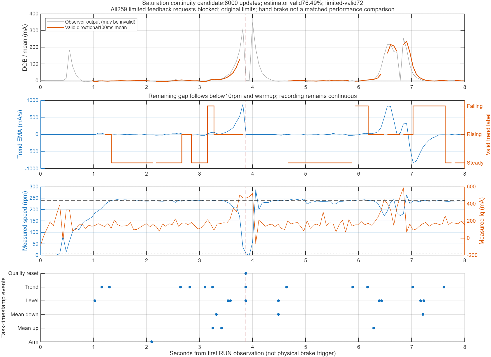

# 饱和观测连续性候选（2026-10-24）

用户要求只改饱和分支并直接准备一次人工板测。当前选定正常限速500 rpm、目标240 rpm、总Iq±0.50 A、DOB增益0.25/独立补偿上限±25 mA不改。正式B回退镜像、boot及配置不改。

## 最小变化

独立编译选项`FOC_DOB_SATURATION_CONTINUE`只在`DobSaturationContinuousCandidate`开启，正常默认及旧候选不变。前置要求是已修复的持续8秒记录、正常500 rpm及原预滤波质量门控。

1. 把速度总输出饱和和电压矢量限幅作为`DOB_MONITOR_SATURATED`元数据。测量有限、来源/时序/序号合格且原电流准入及Id门控合格时，继续更新实测Iq LPF、Id LPF与原2 Hz机械观测器，不仅因饱和而复位或重新预热。
2. 仅从“测量错误”标记判断中剥离`MEC_SATURATED`，其余任何原标记仍拒绝；饱和同时有坏数据时仍按原策略处理。
3. `current.valid`现在表示估计有效，允许与状态128共存。速度环接入新补偿另行要求状态不含128。因此限幅时反馈仍按原5 ms保持/20 ms归零规则运行；解除限幅后，仅当前合格估计能够重新跟踪。补偿斜率0.25 A/s、独立/总Iq限幅及总输出anti-windup完全不变。
4. 来源异常、200 mA可疑点隔离/3点一致确认、Id60 mA持续20 ms、长缺口、低速门限、首次初始化/真正复位后的预热及全部独立保护未放宽。

## 日志

沿用133帧左右的整轮60 ms记录和32项任务时刻事件环形队列。状态128且`dob_valid=true`表示“测量可信的限幅中估计”，不表示允许新补偿。

新增32字节`dob_saturation_audit`：总观察次数、Iq限幅样本数、电压限幅样本数、限幅中有效估计数、来源/时间/序号等输入复位数、被阻止的新反馈请求数、电流准入跳点数、预热帧数。`input_resets`不是全部内部复位次数，不用于掩盖Id/生命周期等其他复位。

板测前只读`SAT CFG`必须回读`EST_ON_LIMIT=1 FB_ON_LIMIT=0 INPUT_GATES=ORIGINAL HOLD_US=5000 ZERO_US=20000`；否则不START。主机同时回读正常500/500、目标240和其余限幅。

## 验证与构建

相关22项回归通过：新饱和/反馈/板测门控6项，原连续记录8项、正常DOB4项、Id预滤波200 mA4项。实际C实现对照包含Iq和电压限幅、恒速下实测电流阶跃、限幅不复位、不增加新反馈、解除后恢复跟踪、+700 mA Id尖峰不污染LPF、坏时序/坏输入标记继续复位、持续Id仍失效及故障停用。两种优化等级都通过。

FOC、电流环、硬保护、FSM、pipeline关键函数预处理结果不变。速度更新仅加入“限幅估计不作为新反馈”条件及只读计数；原PI/FF/摩擦/总限幅数学和`DobFeedback_Update`保持一致。

BIN226792 B，SHA256 `43f3188b07eca8440bd2e140d6a0d8e6783d3e9ae9a4636548ea466589a9751f`；ELF SHA256 `22d45928b1496ef4078076ed1cbc71d1e6a2c32d109919ea7fe502e3a3ffa1ec`。静态RAM130896/131008 B，较原候选增加32 B。任务栈及原时序预检仍须在板上通过。离线结果不构成真实负载估计精度验证。

## 板测约束

人工已确认12 V关闭、MCU供电、动态制动器释放、500 rpm机械允许、空载固定/防护及接线/限流0.5 A不变且人在场。只写非活动A，两次完整回读后另行确认上电。原预检通过才一次240 rpm普通START，短暂动态制动并立即释放；保护触发停止、不自动重试。采完关闭输出并保存Flash/RAM，人工关12 V后才恢复B。

## 一次板测结果

暂存及双重完整回读通过：`tmp/dob-trend-continuous-stage-1792822927445877900.json`。人工上电且确认无报警后，先回读新SAT CFG及原500/500 rpm阈值和其他限幅，再经原校准/时序/栈预检，只发送一次START。

运行回执：`tmp/dob-trend-continuous-run-1792823185476494900.json`，记录PASS，未触发独立保护，约8秒按RUNDOWN_TIMEOUT退出、CONTACT=0；这是观察完成，不是拧紧成功。

### 直接验证到的变化

|全速率计数|结果|
|---|---:|
|原DOB/分类/反馈更新|均8000次|
|Iq限幅样本|259|
|电压矢量限幅样本|0|
|限幅中仍有效的估计|72|
|限幅来源禁止接入新补偿|259|
|来源/时序/序号等输入复位|0|
|电流准入跳点|240|
|预热帧|1292|

证明本次“饱和单独不复位且不作为新补偿”的分支实际被执行。电压限幅分支本轮未触发，其连续性仅有离线测试证据。`input_resets=0`不代表所有内部复位为0，低速等模型复位仍存在。

估计有效6119/8000（76.4875%），新补偿来源有效6046/8000（75.575%）；两者不同正是保留限幅反馈排除等条件的预期结果。前轮66.275%与本轮76.4875%只作描述，手动制动过程不等效，不能归因为策略带来了10.21个百分点的可重复改善，更不能据此宣称实际负载估计精度已验证。

### 剩余失效原因

本轮制动时速度降到10 rpm以下。60 ms采样记录：3.816 s状态1152（限幅+电流准入）；3.877/3.937 s状态132（限幅+低速）；3.998 s状态136（限幅+预热）。它们不是“仅饱和导致复位”，其他原质量门控仍正确生效。

分类器仅1次质量清理，3.870985 s至4.641958 s恢复有效趋势，约770.973 ms。期间是低速/准入失效后重新预热及趋势证据重建；采集持续运行，没有提前冻结。其余后段负载变化、均值和标签切换都被记录。

初次均值代理时趋势已RISING，后续回落片段被质量清理打断，不输出可信的负载/卸载确认延迟；原始时间差不能替代物理制动到检测的总延迟。

### 控制与时序

转速峰值295.829 rpm（240目标上的超调55.829 rpm）；Iq命令峰值0.50 A，累计限幅258.946 ms，DOB补偿峰值25 mA。FOC最大33.594 µs、deadline miss=0、CCR late=0、最小提交余量14.618 µs；CUR_CONFIRM故障0。单次手动制动不能与上一轮不同负载作严格控制性能优劣比较。

记录133帧覆盖0～7.993020 s，分类持续至7.999004 s；29项任务时刻事件完整，两个环形缓冲均未覆盖旧项。原始Flash/RAM、趋势CSV和事件CSV保存在运行回执旁。

### 关断与回退

人工确认12 V关闭后只恢复B：`tmp/dob-trend-continuous-restore-1792823287394706500.json`通过，CPU停在B入口，SD/MOE/AOE/CCER全关，B应用未运行。独立审计核对前后应用/boot/config全片一致及原B CRC627317606，未改正式B。之后没有再次启动。

独立分析：`tmp/dob-saturation-analysis-20261024.json`，重新从RAM解码并核对所有CSV/RAM哈希、全速率计数和B恢复，审计PASS。

