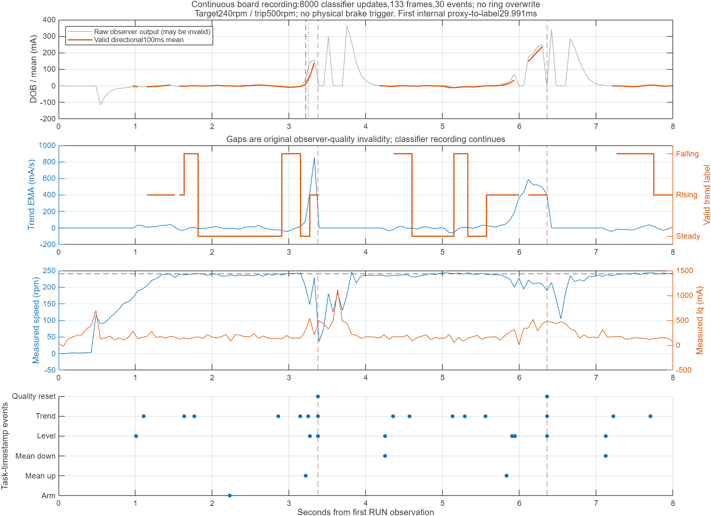

# 趋势记录提前冻结修复（2026-10-24）

## 根因与修改

旧只读影子观察在第一次10 mA均值代理触发后采112帧就设置`DTS_DONE`，入口直接返回，分类器跟随短记录窗口一起停止。上轮N=3583、原DOB N=8000，故漏掉后续强制动。控制/DOB本体并未因此冻结。

新增独立ABI2候选`DobTrendContinuousTrip500Candidate`。原分类器不改，每次原RUN任务观察都继续更新；缓冲区次数/触发/环绕不参与分类器开关或复位。原ABI1源文件及已测BIN/ELF保留，以免旧回执被新格式误读。

## 数据覆盖和内存

- 每60 ms保存一帧，138帧覆盖原8秒RUN。包含原DOB、方向化均值、趋势EMA、测得速度、Iq、原DOB状态、分类/趋势有效性和标签。无第一次触发后冻结。
- 速度日志分辨率0.1 rpm、Iq日志分辨率1 mA，仅在日志编码时量化，FOC反馈和控制计算仍用原浮点值。
- 32项事件环形队列保留任务时间戳：基线锁定、均值10 mA上/下交叉、等级切换、趋势切换、质量清理和STOP。事件时间不受60 ms记录间隔量化。均值交叉是内部代理，不是物理制动时间。
- 点/事件环绕继续写入，明确累计覆盖数；分类器继续更新。主机不把覆盖后的数据称为完整历史。
- 复用原4608字节点缓冲：分类器1012＋138×24＋32×8=4580字节。静态头100字节，比旧头92字节增加8字节；静态RAM130864/131008字节。原实时栈检查仍保留。

## 不变部分

正常超速阈值500 rpm，目标240 rpm，Iq±0.50 A，DOB增益0.25/补偿±25 mA。FOC20 kHz、原PI/S曲线/加速度FF/摩擦/BEMF/原DOB门控与保持规则、PWM pipeline、CUR_CONFIRM、CURRENT_INVALID、编码器/时序保护、IRQ和原8秒/12秒限时均未改。趋势仍不参与控制。原B/boot/config保持作回退。

## 离线证据

28项相关回归通过：新增7项连续观察/真实内存解码/上板门控，另原500 rpm边界6项、正常DOB4项、Id预滤波200 mA4项、普通FSM板测脚本7项。

拿到板测后另增加“质量清理不能冒充有效卸载延迟”报告回归，新增套件共8项、相关总计29项通过。该补充仅修正主机结果资格判断，不改本轮上板镜像或原始回执。

在每个8000输入时刻，把候选内分类器状态与同一原分类器独立运行的状态逐字节比较，全部一致；模拟早期小触发后第5秒大负载、第6秒卸载，记录覆盖0～7.98秒，分类持续到7.999秒；另测试14秒环绕、事件覆盖、计时回绕和STOP。ARM ABI独立静态断言通过。真实FOC/控制/保护/FSM关键函数预处理结果与原500候选一致。

编译通过：BIN226332字节，SHA256 `f0a28f2904b49fd59de68aeb9dfd8f7b15dfd1c0e9843e1e5861e6fe099d7668`；ELF SHA256 `072aeac30baf0296e7bcbd80686d20ab07e87e83b508f2071a033f2ab19573db`。无硬件运行结论由离线结果推断。

## 板测验收

非活动A双重回读、另行上电确认、原校准/功率关闭预检后只一次普通START。人工在防护外短暂动态制动并立即释放。保护触发不重试。主机保存整轮Flash/RAM、60 ms趋势CSV、任务时刻事件CSV；验证分类器N与原反馈更新N一致、首帧从RUN起点开始、末帧距最后分类更新不足62 ms。事件覆盖单独报告，不将已激活标签的后续重新进入当作首次确认。缺少物理制动信号，仍不输出物理绝对检测延迟。

## 板测结果：提前冻结已修复

运行回执：`tmp/dob-trend-continuous-run-1792820740959138700.json`。原校准/时序/栈预检、板端ABI2及500/500 rpm双阈值回读通过，仅一次START，原8秒RUNDOWN_TIMEOUT退出，未触发独立保护、CONTACT=0。此次只完成观察，不能称为拧紧成功。

- 分类器及原反馈更新均8000次，分类器时间跨度7.999017 s；133帧覆盖0～7.991009 s，距最后更新8.008 ms。记录未覆盖旧点。
- 30个事件全保留，事件未覆盖旧项。5～7秒后段变化持续有记录，不再在早期代理后冻结。
- FOC最大33.659 µs、deadline miss=0、CCR late=0、最小提交余量15.129 µs；CUR_CONFIRM故障0。
- 转速峰值253.431 rpm，总Iq命令峰值0.50 A，累计限幅437.095 ms；DOB补偿达到25 mA上限。原DOB有效输入5302/8000（66.275%）。与之前手动制动的负载过程不等效，不据此声称控制性能改善。

### 事件解读

时间起点为首个RUN观察，不是制动开关时刻。

|事件|时刻|
|---|---:|
|第1次均值上穿基线+10 mA|3.218996 s|
|第1次RISING确认|3.248987 s|
|第1次HIGH确认|3.274033 s|
|第1次分类器质量清理|3.376995 s|
|恢复有效等级（LIGHT），均值代理下穿|4.250003 s|
|恢复有效趋势（FALLING）|4.355025 s|
|第2段RISING已激活|5.557985 s|
|第2次均值上穿基线+10 mA|5.833031 s|
|第2段HIGH确认|5.942006 s|
|第2次分类器质量清理|6.362007 s|
|再次恢复有效趋势（FALLING）|7.221005 s|

首次内部均值代理→上升确认为29.991 ms。代理本身经过DOB及100 ms均值处理，不能将30 ms当作从真实施加制动算起的总延迟，也不能与仿真真值起点的134 ms直接比较。

第二段均值上穿时趋势已经RISING，不输出负延迟或0 ms。第1段质量清理后，4.250 s恢复时均值下降、4.355 s出现FALLING，原始时间差105.022 ms仅为算术差值：负载片段已被质量清理打断，独立分析将其标为`quality_reset_interrupts_episode`，不作为可信卸载检测延迟。原始回执保留原始算术结果，不覆盖证据。

两次清理至有效趋势恢复分别约978.030 ms和858.998 ms。这是原DOB输入失效/预热与分类证据重建造成的质量空窗，期间记录器仍持续运行；不是本次提前冻结问题，也没有通过放宽质量门控隐藏。后续若要接入自适应控制，必须独立处理这类质量空窗及回退行为。

### 文件与闭环

- 整轮趋势CSV：`tmp/dob-trend-continuous-run-1792820740959138700.trend.csv`。
- 任务时间戳事件CSV：`tmp/dob-trend-continuous-run-1792820740959138700.events.csv`。
- 重新从RAM解码、闭合RAM/CSV哈希、核验持续更新与覆盖的独立分析：`tmp/dob-trend-continuous-analysis-20261024.json`，审计PASS。
- 人工关闭12 V后，原B启动选择恢复回执：`tmp/dob-trend-continuous-restore-1792820964519768800.json`。B/boot/config未改，CPU停在B入口，输出关闭；之后未运行电机。

MATLAB离线生成的整轮曲线如下。红色竖线表示分类器质量清理；空窗有持续记录，不是提前停止采集。

