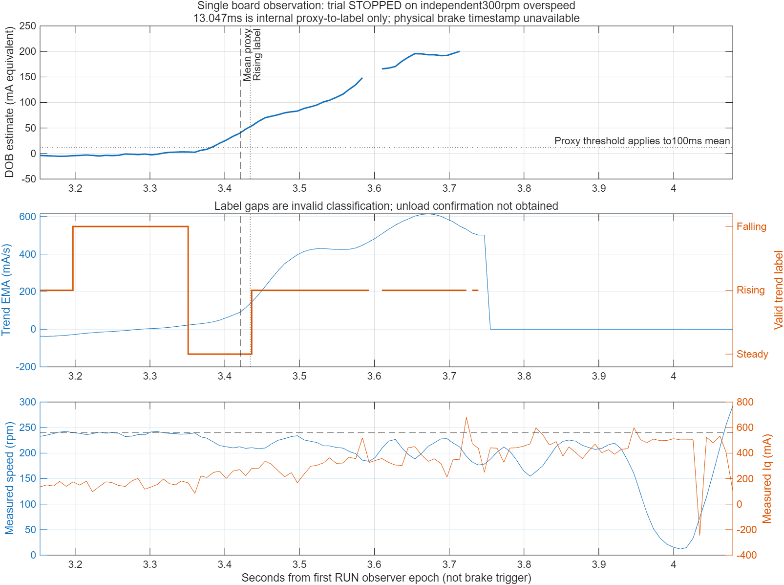

# DOB 趋势影子观察候选（2026-10-24）

目的：在原正常拧紧 A 中观察负载估计趋势标签的真实时序。标签不参与速度、Iq 限幅、DOB 增益或 FSM 控制，不移植软件仿真的短来源缺口修复。正式 B 不改动。

## 候选与验证

- 构建：`foc2_app_a/build/DobTrendShadowCandidate`，独立 `FOC_DOB_TREND_SHADOW` 编译选项。
- BIN 225752 B；Flash 链接占用225752 B/229376 B；静态 RAM130856 B/131008 B。RAM余量152 B不等于任务运行栈余量，板端原栈/时序预检仍必须通过。
- 分类器/记录复用原机械采集点数组，4468 B≤4608 B。静态头92 B和指针4 B。禁止与原 Id/raw trace 同时构建。
- 标签逻辑：100 ms证据窗，100 ms趋势 EMA、80 ms趋势确认，原10/25 mA等级阈值和5 mA滞回，30 ms等级确认，60%覆盖、60 ms跨度、20 ms分类缺口清理。
- task-only，在原控制ACK和原DOB观察更新后运行。FOC IRQ不执行分类或日志。
- 新增7项回归通过；另19项原正常FSM、Id预滤波200 mA、CONTACT20/观察10、正常DOB生命周期回归通过。
- 7000个合成输入时刻逐点对照选定Simulink双精度逻辑；单点被拒绝输入不进分类窗，不重置分类器；长缺口、计时回绕、预触发环形记录有回归。此处不替代原DOB质量检查。
- 原FOC、电流环、encoder/control/guard/FSM关键函数预处理结果与已有候选一致。

## 本轮运行参数

240 rpm普通START，Iq限幅±0.50 A，DOB原增益0.25，补偿限幅±0.025 A；8 s rundown超时、12 s板端限时，原独立超速/过流/电流有效性/编码器/时序保护全部保留。初始DOB反馈OFF，只有输出关闭时通过原命令开启至原正常0.25配置；不改控制参数。

## 采样与延迟定义

分类器按实际encoder任务时间戳更新；日志8 ms一帧。首次RUN后至少2 s，原参考到240 rpm且连续40 ms满足速度误差≤5 rpm、参考加速度为0且分类有效时记录基线。100 ms方向化DOB均值比基线增加10 mA定义“负载变化代理时刻”；记录趋势确认真实任务时间戳。触发前32帧、触发后112帧，共144帧；若无触发则保存末段环形帧。

真实制动开关时刻和扭矩均不可测。因此只报告内部代理至分类确认的相对延迟，不能将其当作制动施加至确认的绝对物理延迟，也不能直接与仿真ground truth起点的134 ms等同。代理出现时趋势已激活、未触发、缺少确认、提前停机或估计无效均显式标记，不以0 ms代替。

## 人工动作与闭环证据

先在12 V关闭时独立写入/回读非活动A，保留B/boot/config；随后另行确认12 V开启、无报警和人在场，校准及功率关闭预检通过才一次START。制动器初始释放，启动后约3秒在防护外短暂施加并立即解除。用户已确认制动器允许动态制动，但力度不可控；若自然停转、CONTACT或保护退出，保留原行为，不重试、不放宽保护。

采完关闭输出、暂停CPU、保存Flash/RAM及CSV，人工关闭12 V后才恢复原B选择并停在B入口。板测结果与回执另行保存；构建与离线通过不代表实机延迟或负载性能通过。

## 本轮实际结果：因独立超速保护停止

本轮只发送一次START，预检、原模型/限幅配置回读通过。未重试。运行回执 `tmp/dob-trend-run-1792818407060467100.json` 保留 `pass_=false` 和原始失败 `Protection fault; no retry`，不能将部分趋势记录改报整轮通过。

以下相对时间统一以首个RUN观察时刻为0；不是人工制动开关时间。

|事件|相对时间|
|---|---:|
|满足稳态/质量并锁定基线|2.063064 s|
|100 ms DOB均值相对基线增加10 mA（代理）|3.420995 s|
|RISING趋势标签确认|3.434042 s|
|HIGH等级确认|3.477017 s|

代理→RISING为 **13.047 ms**。代理本身经过原DOB滤波和100 ms均值窗，确认计时可早于该代理时刻开始，**13 ms不是从真实施加制动算起的总延迟，不能与仿真真实负载起点的134 ms直接比较**。本轮没有制动电气触发和扭矩真值，不输出绝对制动检测延迟。

记录保留108/144帧，因保护退出而截短。采样间隔约8～9 ms，但事件时刻由每个约1 ms任务更新独立锁存；不是从8 ms日志插值得到。分类器实际任务dt范围944～1057 µs。首次RUN至停止共4082个观察时刻，原DOB有效2697个（66.07%）；截取窗口的分类有效65/108（60.19%），两种统计的时间范围不同。

制动过程中速度下降且总Iq命令达到原0.50 A限幅。截取窗口原DOB状态码计数：0（有效）65帧、128（饱和）19帧、8（预热）17帧、1024（电流质量）7帧。分类器发生1次质量清理；约3.755 s后UNKNOWN/无效。没有取得卸载代理或FALLING确认，因此不能报告卸载检测延迟，也不能宣称突加/卸载全过程分类可靠。

本轮在速度上冲时触发原300 rpm独立超速保护：故障快照过滤速度300.1808 rpm，原始速度344.2383 rpm，编码器有效且错误数0。稀疏STATUS先显示降到约19.8 rpm、后迅速上冲；这与卸载后上冲相符，但不能在无制动触发信号下精确归因或定位解除时刻。DOB补偿峰值达到原25 mA限幅。

时序：FOC wall max33.188 µs；deadline miss=0；CCR late=0；最小提交余量15.135 µs；CUR_CONFIRM故障0。趋势记录器自身DWT最大片段194.553 µs含ADC抢占，不等于其独占CPU时间，不将此值与FOC50 µs周期直接混比。时序证据未显示本轮保护由deadline/CCR late引起。

本轮趋势标签没有任何控制接线，未改变参考速度、电流限幅、DOB增益或FSM。因此不能把本次速度上冲归因于趋势确认延迟，也没有验证未来自适应接入后的控制性能。

## 关断与后续

人工确认12 V关闭后，恢复回执 `tmp/dob-trend-restore-1792818484415940100.json` 通过：B/boot/config与运行前一致，B选择已恢复（generation1201），CPU停在B入口，SD/MOE/AOE/CCER全部关闭，B应用未运行。A候选留在非活动区；本轮结束后不再运行电机。

分析审计：`tmp/dob-trend-analysis-20261024.json`，重新从RAM解码并闭合CSV/RAM哈希；不覆盖原故障回执。下一步应先用本轮记录回放饱和/质量失效/卸载场景，验证UNKNOWN或失效时的安全回退，再考虑自适应接入。实机对照需可重复、可控的较轻负载，不能用提高超速阈值替代卸载风险分析。

MATLAB生成的同时间轴记录曲线：

