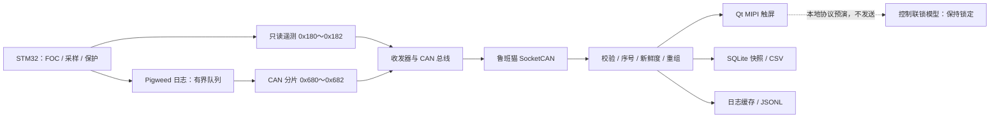
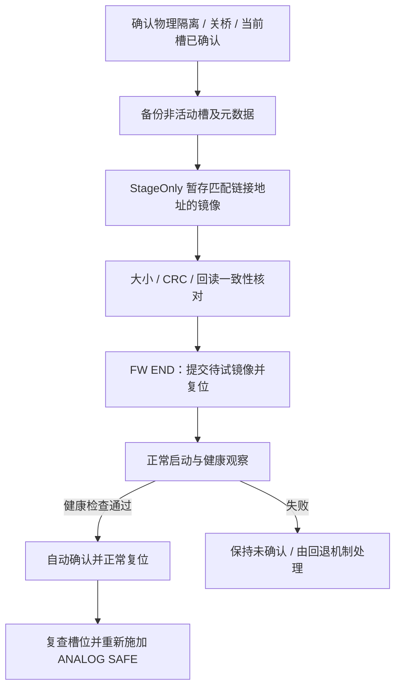

# 第十一章：鲁班猫 MIPI 上位机开发与排障总结

> [!summary] 本章结论
> 将鲁班猫从“能够运行 Linux 的板卡”建设成了本项目的 MIPI 触屏上位机：接收 STM32 的 CAN 状态和测量数据，显示实时角度/转速趋势，保存 SQLite 诊断快照、浏览并导出 CSV，再接入 Google Pigweed 日志的 CAN 分片传输、级别筛选和 JSONL 导出。界面采用 Qt Widgets，不是最终移植了 LVGL。
>
> 当前完成的是**只读观测、工程诊断和受限通信基础设施**。触屏 ARM/START/STOP 仍锁定；扭矩标定、可信功率级回读、实体急停联锁、完整拧紧作业追溯尚未验收，不能写成“工业拧紧系统已经全部完成”。

> [!info] 记录口径
> 本笔记依据仓库代码、分阶段验收记录和现场对话整理。早期文档中的“当前 B 槽”“尚未实现”等描述保留当时语境，不直接当成最终状态。最后一次固件验收记录是 2026-09-30 的已确认 A 槽；最新按钮修复由用户回复“可以了”确认，未在此次写笔记时重新远程测量设备。
>
> 尚未指定 Obsidian vault，本文件先存放于项目根目录。文内相对链接以项目根目录为基准；导入其他 vault 时需一并复制对应附件，或调整链接。

## 1. 为什么让鲁班猫做上位机

原来的 PC/COM5 工具适合串口诊断、升级和调试，但不适合直接作为设备上的操作终端。项目需要一个能固定在设备旁边、开机显示、触摸操作、观察过程和保存数据的上位机。

职责划分如下：

| 组成 | 承担的职责 | 不应承担的职责 |
| --- | --- | --- |
| STM32G474 | FOC、电流/编码器采样、保护、拧紧状态机、最终执行决策 | 依赖 Linux 界面的及时刷新来维持实时保护 |
| 鲁班猫 RK3568 | MIPI 显示、触摸、CAN 数据解析、趋势、诊断记录、日志 | 绕过 STM32 联锁直接开桥或输出 PWM |
| CAN 链路 | 设备状态、测量、受限诊断及低优先级日志 | 把底层 ACK 当成“电机命令执行成功” |
| USB-TTL 备用 | 独立读取 STM32 串口日志 | 为读取日志引入供电、复位或运动命令 |



## 2. 硬件与运行环境：先确认“到底接到哪里”

### 2.1 鲁班猫环境

- 板卡：LubanCat-2H，RK3568。
- 系统：Ubuntu 20.04.6，Linux 4.19.232，aarch64。
- MIPI：DRM `DSI-1`，1024×600；有 `/dev/dri/card0` 和 `/dev/fb0`。
- 触摸：Goodix，审计时为 `/dev/input/event2`，设备路径含 `i2c-5/5-005d`。
- CAN：Linux 接口名 `can0`，驱动 `rockchip_canfd`，设备节点对应 `fe580000.can`。
- 本地 Windows 预览使用 Qt6；板上部署使用已有 Qt5，验收记录为 Qt 5.12.8。

**Linux 的 `can0` 不等于芯片手册中的 CAN0。**本板正在使用的是 `/can@fe580000`，设备树符号为 `can1`，复用组选中 `can1m0-pins`。

### 2.2 J32 为什么丝印 SDA/SCL，却能做 CAN

运行设备树实际显示：

```dts
can@fe580000 {
    pinctrl-names = "default";
    pinctrl-0 = <0x222>;
    status = "okay";
};

can1m0-pins {
    rockchip,pins = <0x01 0x00 0x03 0x13e
                    0x01 0x01 0x03 0x13e>;
    phandle = <0x222>;
};
```

这里 GPIO1_A0/A1 被选为 CAN1_M0，而不是照着排针丝印使用 I²C。具体接线依据用户提供的 EBF410331 V1R0 原理图：

| 位置 | 网络/引脚 | 本项目使用功能 | 接到外置收发器 |
| --- | --- | --- | --- |
| 鲁班猫 J32-2 | GPIO1_A0，丝印/网络 SDA | CAN1_RX_M0 | RXD |
| 鲁班猫 J32-3 | GPIO1_A1，丝印/网络 SCL | CAN1_TX_M0 | TXD |
| 鲁班猫 J32-4 | GND | 共地 | GND |
| 鲁班猫 J32-1 | VCC_I2C / 3.3 V | 非 CAN 数据脚 | 不能当作模块的 5 V 电源 |
| STM32 CN10-3 | PB8，AF9 | FDCAN1_RX | RXD |
| STM32 CN10-5 | PB9，AF9 | FDCAN1_TX | TXD |

> [!important] CAN 逻辑侧不照搬 UART 的交叉接法
> MCU TX → 收发器 TXD；收发器 RXD → MCU RX。两端模块之间才是 CANH ↔ CANH、CANL ↔ CANL。SDA 是板卡默认丝印，不是要把“RX 改接 TX”的依据。

两侧使用 SIT1042AQT/3 模块，需区分模块 5 V 供电与 3.3 V VIO。用户确认实物模块没有 STB，后续不能再把“检查 STB”当作这块模块的必做步骤。

J32 路径包含 510 Ω 串联电阻和 4.7 kΩ 上拉，应纳入波形与电气检查。曾尝试 J34，但本笔记的可追溯接线依据是 J32/CAN1_M0；**不凭对话推断 J34-2 的最终复用**，换接口应重新核对该次运行设备树及实物网络。

STM32 的 PA11 已用于 TIM1_CH4，不能为了 CAN 占用它。PB9 优先取 CN10-5；Arduino A4/CN7-36 的 PC1/PB9 共享节点可能与 PC1 的电机 PWM 冲突。

### 2.3 逻辑分析仪怎么接

逻辑分析仪并联监听 TXD/RXD，并与逻辑侧共地，不替代原连接。此前 D0 接鲁班猫侧 RXD、D1 未接时，只能判断 RXD 上有没有变化，不能比较发送端 TXD 与接收端 RXD 的关系。

- RXD 未接回 CAN 控制器时，接收和总线反馈不完整；仅看到 TXD 不能证明通信成功。
- RXD 上有波形，证明信号到达这个测点，不证明 Linux 应用已得到合法帧。
- 万用表测得 3.3 V 可能只是空闲电平，不代表 500 kbit/s 波形、帧时序和 ACK 正常。
- 本项目逻辑分析仪测逻辑侧，不能把未核实额定范围的数字输入直接接 CANH/CANL。

## 3. 开发过程：从链路探针到实屏日志

| 阶段 | 做了什么 | 得到的证据/边界 |
| --- | --- | --- |
| 9 月 27 日：环境审计 | 核对 CAN 控制器、设备树、J32、STM32 引脚、MIPI/Goodix、工具链 | 原生 CAN 可用，不需要 I²C-CAN 控制器；最初提过 LVGL，但未实际移植 |
| 基础 CAN bring-up | 构建电机关闭的 CanProbe，随后采用 SRAM 独立诊断，发送 `0x701`、验证反向 `0x321` | 初轮失败并出现 BIT0/bus-off；后续基础双向收发通过，不代表完整 APP 健康 |
| 9 月 28 日：正式 APP 排障 | 通过 SWD HOTPLUG 查看程序停点和功率输出，发现启动电流零点校准失败 | 区分“通信链路坏”与“应用尚未启动通信任务” |
| MIPI 首屏 | Qt Widgets + SocketCAN，复用原项目 DRM UI plane，沿用 EGLFS/KMS/openvt | 从仅亮背光到能显示真实界面；离屏截图与实屏确认分别记录 |
| 9 月 29 日：只读遥测 | 加入 `0x180` 状态、`0x181` 角度/Iq、`0x182` 转速/母线估算 | 正常 APP 经 A/B IAP 后实收三类帧，各约 10 Hz |
| 趋势与实屏验收 | 新鲜度/序号跟踪、30 秒双轨趋势 | 用户确认 MIPI 显示且能触摸切换曲线；长时间总线可靠性未全部通过 |
| 快照与导出 | SQLite 事务、记录列表、CSV 原子导出 | 真实数据库和 `capture-6.csv` 对比通过，不等于正式作业追溯 |
| 诊断与控制边界 | CAN HEALTH、有限恢复、无动作请求/回执诊断、控制协议离线模型 | 双向诊断可验证；触屏控制仍锁定，不接入电机执行 |
| 9 月 30 日：Pigweed 日志 | 从串口方案转为 CAN 主链路，USB-TTL 备用；队列、分片、CRC、重组、筛选、导出 | A/B 实收新生成文本与 token 日志；备用串口打开成功但仍无字节 |
| 最新触屏修复 | 下拉框改为直接选择按钮，独立目录部署脚本 | 本机界面测试通过，用户随后确认可用；此次未重新远程读服务状态 |

## 4. 上位机具体功能及实现方法

### 4.1 八个页面，各自做什么

| 页面 | 已实现功能 | 尚未开放/不能误解的部分 |
| --- | --- | --- |
| 总览 | 在线/过期状态、角度、转速、母线估算、软件故障和使能状态、趋势 | 无效数据不显示成正常零值；Iq 不冒充扭矩 |
| 作业 | 启动前实时观测与条件提示 | 不是完整工单执行页，不给出可启动许可 |
| 控制 | 联锁缺项、本地 ARM/START/STOP 报文预演、被动回执观察 | 真正动作按钮禁用；预演不写 `can0` |
| 曲线 | 最近 30 秒真实角度/转速双轨趋势、手动保存快照 | 没有已标定扭矩曲线，也不是完整拧紧过程存档 |
| 配方 | 展示预期参数与未验收状态 | 配方下发未开放，未实现正式版本化配方管理 |
| 诊断 | CAN 接口状态、帧/序号及链路问题观察 | 接口 UP 不等于设备业务在线 |
| 记录 | 最近 50 条诊断快照、缺序号/样本数/时长、选中并导出 CSV | 不含正式工单、合格判定或可靠同步时间 |
| 日志 | CAN/USB-TTL 来源选择、级别筛选、暂停显示、导入、重新连接、JSONL 导出 | 屏内 token 尚未实时反解码，缓存不是无限黑匣子 |

### 4.2 Qt 与 SocketCAN 如何结合

使用 C++17、Qt Widgets、Qt Sql 和 CMake。同一工程兼容 Windows Qt6 预览与 Linux Qt5 实机，方便先做离线逻辑/界面测试，再上板。

Linux 接收器使用非阻塞 `PF_CAN / CAN_RAW` 套接字，绑定 `can0`。通过 `QSocketNotifier` 处理可读事件，每次回调最多处理 128 帧，避免大流量把 UI 事件循环长期占满。状态界面定时刷新约 200 ms，日志界面约 250 ms；CAN 接收与绘图刷新不是一帧对应一次重绘。

当前 HMI 没有运动控制发送路径。诊断脚本曾发送受限测试帧，不应把脚本行为写成“触屏已经可以发 START”。

主要代码位置：

- [界面与 CAN 接收：main.cpp](lubancat_hmi/src/main.cpp)
- [状态跟踪：status_v1.h](lubancat_hmi/src/status_v1.h)
- [测量解析：measurement_v1.h](lubancat_hmi/src/measurement_v1.h)
- [趋势缓存：telemetry_history.h](lubancat_hmi/src/telemetry_history.h)
- [启动前观测：preflight_observation.h](lubancat_hmi/src/preflight_observation.h)
- [控制门槛：control_workflow.h](lubancat_hmi/src/control_workflow.h)

### 4.3 MIPI 显示不是“程序运行了就一定显示了”

普通 Qt/EGLFS 启动曾只看到蓝色背景或背光。离屏能生成截图，说明 QWidget 渲染和业务代码可工作，但不能证明画面已出现在 MIPI 扫描输出上。

最终复用原屏幕项目的 `DrmUiPlane`：

```text
Qt Widgets 生成界面
       ↓
DrmUiPlane：ARGB 界面图层
       ↓
DRM/KMS：video_port1 / DSI / 1024×600
       ↓
MIPI 实屏；Goodix 触摸事件回到 Qt
```

板上使用原项目的 EGLFS KMS overlay 配置、atomic 设置以及 `openvt` 的 VT1 启动方式。DRM 检查确认存在 1024×600 的 ARGB 图层，用户再确认实屏显示和触摸。

这是复用现有可靠显示路径的工程选择，不是已经写好了独立 DRM 驱动。当前 CMake 仍依赖原目录 `/home/cat/lubanmao-cpp-rknn/qt_cabin_panel/src`；迁移到另一块板时要处理这个依赖。

### 4.4 CAN 遥测协议：不直接把串口 ASCII 搬进 CAN

三类正式遥测均为经典 CAN、标准 11 位 ID、DLC=8、500 kbit/s，多字节字段为小端，正常监控任务约每 100 ms 尝试发送一组。

| ID | 8 字节载荷 | 显示/校验含义 |
| --- | --- | --- |
| `0x180` | `version:u8, mode:u8, flags:u8, fault:u16, seq:u16, reserved:u8` | version=1、reserved=0；flags 表示 FOC 请求、故障锁存、编码器有效、SD 输出高 |
| `0x181` | `angle_mdeg:i32, iq_mA:i16, seq:u16` | 相对机械角单位 0.001°；Iq 单位 mA；最小整数作为无效标记 |
| `0x182` | `vbus_mV:u16, speed_deci_rpm:i16, seq:u16, valid:u8, version:u8` | 电压单位 mV，速度单位 0.1 rpm；valid 位分别控制电压/速度有效性 |
| `0x183` | 扭矩帧草案 | 未标定、未启用，不能当作已有功能 |

`0x180` 的 fault 只是故障原因低 16 位。SD 是 GPIO 输出状态，不是驱动功率级的独立反馈。角度是相对机械角，不是已经标定的工具绝对角；电压是估算，Iq 不是实际拧紧扭矩。

### 4.5 在线、有效、同组：三道不同的判断

单纯判断“收到了帧”容易把旧数据、重启前缓存或重复帧当成实时观测，因此增加：

1. **帧校验**：类型、ID、DLC、版本、保留位、有效位正确。
2. **序号判断**：有效窗口内重复/倒退序号不刷新；支持 16 位回绕。
3. **新鲜度**：单调时钟计算，500 ms 内有效，501 ms 过期。
4. **关联检查**：趋势只接受状态/角度/速度均有效、新鲜且序号相同的组。
5. **重启恢复**：状态超时后可重新建立序号基线，清除旧测量/趋势，避免旧值瞬显。

序号只在成功入发送队列后推进；三个流各有计数，不能天然假定永远相同。缺序号说明观察到间隙，不自动等价于 Linux 丢包，更不能不看证据就归因于某根线。

“实时观测全部灰色”可能是状态过期、测量无效、序号不一致或软件安全态，不是界面颜色故障。也不需要所有遥测字段始终有数值：关桥安全态下 Iq 显示“—”是正确行为。

### 4.6 曲线、SQLite、CSV：先做到可核对，再谈追溯

`telemetry_history` 保存最近 30 秒角度/速度，快照接受 2–600 个有效样本。超时清空，恢复后重新采集，不把跨故障的断点强行连成连续曲线。

点击“保存当前只读快照”后，以 SQLite 事务写入：

- `captures`：快照编号、样本数、时长、缺序号、墙上时间及 `clock_verified`。
- `capture_samples`：每点相对毫秒、序号、原始 `angle_mdeg`、`speed_deci_rpm`。

数据库路径配置为 `/home/cat/lubancat_hmi_snapshot/records/telemetry.sqlite3`。这是手动保存，不是一直写盘的全过程记录。

记录页以只读连接列出最近 50 条；CSV 保留原单位，原子写入、拒绝覆盖已有文件，头部样本数与实际行数不一致时取消导出。证据可逐行核对，而不只是看“导出成功”提示。

真实验收记录：7 条快照、1802 个样本，SQLite `quick_check=ok`。用户导出的 `capture-6.csv` 为 24,705 字节、295 个样本、12 个字段，与数据库逐行一致；时长 29,918 ms、缺序号 6。

这些数字是 9 月 29 日那次验收的数据，不是当前数据库的实时统计。由于 `clock_verified=0`、有缺序号、无正式作业身份和扭矩，它只能用于工程诊断，不能作为生产合格记录。

## 5. CAN 双向验证与正式控制：明确不混为一谈

### 5.1 基础通信证据有不同强度

```text
TXD 有波形
  → 信号开始输出
HAL 入队成功 / ENQ 增长
  → 控制器接受了发送请求
发送完成事件 / DONE 增长
  → 总线层完成发送
candump 实收到预期 ID、内容和序号
  → 接收端 SocketCAN 得到合法数据
应用请求/回执同号且结果正确
  → 对应应用协议确实处理了请求
电机动作、传感器结果和安全反馈通过验收
  → 才能进一步证明设备执行结果
```

CAN ACK 表示总线上有节点确认了帧，不携带“某个上位机程序已解析”的证明。即使 TXD 和 RXD 都有波形，也不能直接写成“STM32 已发送成功并能接收业务命令”。

SRAM 独立探针用 `0x701`，后续载荷为 `CAN2` 加大端递增序号；最早 Flash CanProbe 使用 `CAN1`。它们是诊断格式，不是正式 `0x180` 状态。记录过 STM32→鲁班猫 10 帧实收，以及鲁班猫发 `0x321#11223344`、STM32 诊断日志完整收到的反向验证。

### 5.2 无动作请求/回执诊断

实现独立 `0x220` 请求与 `0x2A0` 回执，只允许：

- PROBE：打开 500 ms 的纯内存测试窗口。
- CHECK_VALUE：验证序号、范围及超时，不修改电机。
- STOP_TEST：结束测试窗口，回“观察到，无动作”，**不是电机 STOP/急停**。

实测 8 条请求得到 8 条预期回执；1000 边界接受、1001 拒绝，超时正确，STOP_TEST 幂等。诊断曾造成遥测发送 FIFO 短暂紧张，因此也需要低流量，不能持续压测后还要求所有遥测零跳帧。

### 5.3 为什么有控制页，却还不能触屏启动

用户选择“按正式设备标准实现，安全联锁验收前保持锁定”。因此目前做了协议模型和控制工作流，而没有开放执行。

候选 `0x200/0x280` 协议包含版本、操作码、序号、会话令牌及配方标识；ARM 后 START 需在 500 ms 内、序号为下一号、会话/配方一致并再次检查门槛。它是离线意向评估，不直接调用功率级。16 位令牌仅用于会话关联，不是安全认证或防攻击方案。

当前 UI 可以显示预演十六进制报文，但不会发送。正式执行按钮禁用；软件门槛保持硬件急停、功率反馈、固件控制验收、配方验收等缺项。`CAN_CONTROL_REJECT_ONLY` 是可选拒绝式集成，不等于已部署执行版。

现场曾按授权做过电机试转和原参数 START，用户观察过“只摆动一下”“低速一卡一卡”。这只能说明当次动作和体验，不证明完整拧紧流程合格，更不证明 CAN 上位机运动控制验收。后续仍回到锁定边界。

## 6. Google Pigweed 日志如何加到上位机

### 6.1 为什么最后走 CAN，USB-TTL 仅做备用

已有日志来自 STM32 的 Pigweed `pw_log` 和日志桥，不是另写一个“Google 风格打印窗口”。原工程具备日志缓存、历史、文本/压缩记录和 UART DMA 出口。

最初考虑串口日志，但 COM5 实际是 Windows 上的 ST-Link VCP；鲁班猫不能打开 Windows 的 COM5。ST-Link 同时给开发板供电，不能为了日志随意拔掉它。用户最终选择已有 CAN 主链路，并加 USB-TTL 备用。

备用监听接法为转换器 RX ← STM32 PA2、GND 共地，115200/8N1。PA2 是 LPUART1 TX，PA3 是 RX；不要混成 PB8/PB9。只读监听不接转换器 TX/VCC/DTR/RTS/NRST。

### 6.2 设备端：不在日志产生处直接阻塞发送 CAN

保留原日志与 UART DMA 路径，新增 CAN 镜像队列。日志生产者非阻塞入队，CAN 队列 8 条加当前待发 1 条，单条原文最多 192 字节。`MonitorTask` 作为 FDCAN 的唯一访问者，避免不同任务争用外设。

调度策略：先发送状态/测量，再等待 5 ms 服务日志；每 100 ms 最多投递 2 帧，包含日志统计帧；硬件 FIFO 至少留一格。警告、错误计数非零、error-passive、bus-off 或 FIFO 紧张时暂停日志投递。超过 10 秒的积压记录丢弃并计数。

日志 ID 比遥测 ID 高，配合软件限流让诊断流量让位。20 帧/秒按最坏帧位数估算，在 500 kbit/s 下占用不足 0.62%；这是带宽上限估算，不是现场测量。

### 6.3 CAN 日志分片协议

| ID | 8 字节内容 | 用途 |
| --- | --- | --- |
| `0x680` | version=1、flags、record_id u16、length u8、CRC16 u16、reserved=0 | 新记录头 |
| `0x681` | record_id u16、fragment_index u8、5 字节原文 | 逐片传输，末片零填充 |
| `0x682` | version=1、队列数、队列满丢弃 u16、过期丢弃 u16、完整入队记录数 u16 | 可观察丢弃和队列状态 |

标准 ID、经典 CAN、DLC=8、小端。原文去除末尾 CR/LF，长度 1–192；CRC16-CCITT 初值 `0xffff`、多项式 `0x1021`。flags bit0 标记该次启动第一条完整入队记录，用于接收会话识别。

单条长度 L 需要 `1 + ceil(L/5)` 帧，不含统计帧。因此 192 字节需要 40 帧，在这个限流策略下不适合无损高速刷屏。

HMI 最多重组一条，检查记录号、分片索引、长度、填充和 CRC，超时 10 秒。只把完整合法原文交给 PW/PWT 解析器；不能把“收到一个片段”显示成正常日志。首次启动标记丢失时，不能保证自动识别重启，可用“重新连接”重置基线。

代码：[设备队列](firmware_common/pw_can_log.c)、[共享重组协议](firmware_common/can_log_v1.c)、[HMI 接收封装](lubancat_hmi/src/can_log_receiver.h)。

### 6.4 日志页功能与真实边界

- 最多缓存 300 条，覆盖数量可见；不是无限持久化。
- 级别按钮：全部级别、INFO 及以上、WARN 及以上、ERROR 及以上。
- 暂停仅暂停显示，后台继续接收；筛选不修改设备输出级别。
- CAN/USB-TTL 手动切换，不静默自动换来源；已有记录保留，重组和接收基线重置。
- 导入 `.log/.txt` 最大 2 MiB，只接受合法 `[PW]` / `[PWT]`。
- 保存 JSONL 包括全部保留记录，不局限于当前筛选；保留 raw、来源、会话、设备 tick、导入标记、接收时间。
- 历史导入的接收时间是导入时间，不是设备事件发生时间；`clock_verified=false`。
- Linux 实时合法记录写 `PW_LOG_RX` syslog 摘要，方便核对主实例是否接到，不包含正文。

**日志不等于心跳。**没有新日志可能只是设备没有产生日志，要看独立遥测新鲜度；也不能把日志序号间隙直接等同于 CAN 队列满计数。

### 6.5 token 压缩日志为什么需要固件 ELF

`[PWT]` 保存 token/参数编码，反解码需要产生日志的同版本 ELF 中的字符串字典。已使用仓库里的 Pigweed 官方 Python 实现做离线解码，而不是猜 token。

```powershell
python tools/detokenize_hmi_logs.py <导出的.jsonl> --elf <对应固件.elf> --output <新的-decoded.jsonl>
```

工具保留原文，增加 `decoded_message` 和字典 SHA256；未知 token、参数错误或歧义按失败保留。查表成功本身不证明字典版本匹配，需结合实际固件证据。

当前实屏仍显示 token 和“待字典解码”；**没有实现屏内实时反解码，也没有验收多设备路由日志订阅**。

### 6.6 CAN 日志的实际验收结果

2026-09-30 在 B 和最终 A 上新生成 `LOG TEST 3`、`LOG TOKEN TEST 1`：同一上位机程序收到序号 24–27，文本 3 条、压缩 1 条，`source=CAN can0`、`imported=false`、缺序号 0、CRC 错误 0。对应 A ELF 离线解码得到 `token burst index=0 value=-7`。

启动突发 23 条日志超过 8 条等待队列，丢弃 15 条并显示计数。这是显式有界策略，不写成“日志完全零丢失”。10 秒并行遥测三类帧各 100 帧，状态缺序号 0；CAN 保持 ERROR-ACTIVE、tx/rx 错误计数 0，历史 warn/passive/bus-off 为 3/1/3 且该窗口未增加。HMI 自身 CAN TX=0。

最终固件记录：A 槽 154568 字节，CRC32 `0x53F735F9`，`CURRENT=A CONFIRMED=A PENDING=- GEN=273`；软件安全锁存 `SD=0 MOE=0 FOC=0`。完整哈希、原始 JSONL 和遥测文件见 [日志验收](lubancat_hmi/PIGWEED_LOGS.md) 与 [实收原始日志](lubancat_hmi/evidence-can-a/pigweed-20260930-091358-915908ac-6086-4194-9289-99accaeb4d7e.jsonl)。


*此图来自真实设备数据，但呈现方式为离屏截图，不代替实屏触摸验收。*

## 7. 遇到的问题、判断依据和解决过程

### 7.1 `ip link set can0 up` 返回 Invalid argument

**现象：**重启后直接 UP 失败。

**判断：**尚未设置 CAN bitrate；不是仅凭这个错误就能认定接线坏。先配置 `bitrate 500000 restart-ms 100` 再 UP，随后 `ip -details` 显示正确位时序与 ERROR-ACTIVE。

**改进：**增加 CAN setup systemd 服务，先配置后启动。若已 UP 且参数正确，幂等返回；若已 UP 但参数不符，拒绝扰动运行总线。

### 7.2 “SDA 接 TX 吗”“是不是 I²C 抢占了 CAN”

**判断过程：**不再只看丝印，转查运行设备树 `pinctrl-0`、phandle、`can1m0-pins` 和原理图网络，确认 GPIO1_A0 是 RX、GPIO1_A1 是 TX。Goodix 使用的 I²C5 不等于 CAN 排针被 I²C 占用。

**解决：**按控制器↔收发器同名 TXD/RXD 接法核对；用活跃 pinmux/实际波形验证。设备树声明仍不应替代对运行时占用和实物引脚的检查，不能泛化为“任何接口都没有冲突”。

### 7.3 波形没有、只有窄脉冲，解码器却显示很多 `0xff`

**证据：**截图有过第一路窄低脉冲和 CAN 解码警告、CRC-21/长数据字节，但不能读出一个与预期 ID/数据一致的合法报文。

**判断：**协议解码输出不是独立真值。采样窗口、触发、输入通道、实际位宽、解码位速率或错误波形都可能导致误解析；不能把它写成“已经收到 CAN FD 大数据帧”。

**改进：**先看原始逻辑波形，再与预期 500 kbit/s、经典 CAN 格式和 `candump` 内容对照。500 kbit/s 一位为 2 μs；4 MHz 采样每位约 8 点，24 MHz 约 48 点。采样配置不保证捕获到了发送时段，4 MHz 时 100 M samples 的总窗口约 25 秒，也不意味着当前局部视图就是全段数据。

### 7.4 换线后 ERROR-PASSIVE/bus-off、只有一侧 TX 有波形

**证据：**早期 STM32 出现 BIT0、TEC 上升及 bus-off；鲁班猫虽然当前 ERROR-ACTIVE，累计 warn/passive/bus-off 仍增长。后续也出现过 PB8/PB9 没有预期波形。

**判断与处理：**逐层看初始化、发送 FIFO、控制器完成事件、RXD 反馈、模块供电、总线线序和实际实收。加入 CAN HEALTH 指标：`INIT/FAIL/ENQ/FULL/DONE/TEC/LEC/BO/RECOVER/HALT`。

针对 bus-off 或 FIFO 连续满 2 秒，增加每次启动最多 3 次、恢复间隔至少 5 秒的 FDCAN 有限恢复；次数用完停止自动重试，不无限重启掩盖接线故障。修改后用户确认两侧都测到波形，且有连续正式遥测实收。

> [!warning] 原因不能倒推成唯一结论
> “加恢复后能用”能证明这次恢复了发送路径，不能证明所有历史断连都由同一软件 bug 引起。早期电气/反馈、bus-off、应用启动问题是不同层次的候选或已证实原因，应保留区分。

ERROR-ACTIVE 是允许正常主动错误处理的状态，不等于累计没有发生错误；ERROR-PASSIVE 表示进入更受限的错误处理状态，不等于立即完全不通信；bus-off 表示该控制器退出正常总线参与。验收要看计数增量和持续收帧，而不只看一行当前状态。

### 7.5 `DONE=0` 但鲁班猫确实收到帧

**证据：**控制器发送完成位、实收帧和引脚状态一致，但串口诊断 DONE 没增长。

**根因：**首版统计只接受 `FDCAN_TX_EVENT`，漏掉 `FDCAN_TX_IN_SPITE_OF_ABORT` 所表示的成功事件。

**修复：**成功事件统计兼容两种 HAL 值。这是诊断误报修复，不是可以声称“原来根本没发出，改这个才发出”。同时保留事件 FIFO 丢失计数，避免把缺事件等同于丢帧。

### 7.6 重启后又没帧：启动校准失败，不是自动判定 CAN 坏

**证据：**SWD HOTPLUG 看到正式 APP 停在 `STATIC CURRENT ZERO CAL FAILED` 后的 `Error_Handler`；UART 不响应，通信任务未建立。原程序启动要求 PD6010B 采样供电存在。

**处理分两层：**

1. 在机械隔离和驱动关闭条件下恢复必要采样供电，完成正常校准，而不是删掉校准让电机直接运行。
2. 增加 `StartupZeroCalFaultCommsLoop()`：校准失败时保持功率级/PWM/FOC 关闭，发布故障状态和无效测量，不进入正常电机/命令任务。

故障分支让上位机有机会收到“启动校准故障”，不等于正常运行条件已满足。**通信诊断路径应能在故障时继续表达故障，而不是靠绕过保护恢复通信。**

### 7.7 MIPI 只有背光，重启显示启动日志

**判断：**驱动/背光亮、内核控制台能显示、Qt 离屏能渲染、业务界面已上屏，是四种不同证据。重启照片能看到系统日志，只能说明显示路径有输出，不说明 HMI 自启成功。

**修复：**沿用原 EGLFS/KMS 配置、复用 `DrmUiPlane`，改为 `openvt` 启动，避免旧摄像头/显示服务抢占。分别验证进程、DRM 图层和人工实屏显示；自启配置与整机重启验收分开记录。

### 7.8 Windows 预览：Qt 入口点错误、访问空指针

**第一层：**缺少 `qt_version_tag_6_11` 入口点，构建使用的 Qt 与运行时加载 DLL 不匹配。使用匹配 Qt 路径，避免 PATH 中另一个版本抢先加载。

**第二层：**版本修正后出现读地址 `0x8` 的异常。页面调整移除了某个标签，定时刷新仍访问旧/空标签指针；修正刷新引用后预览退出码 0。

两者是独立问题：DLL 版本匹配不能修复 UI 空指针，修了空指针也不能解决 ABI/版本不匹配。

### 7.9 下拉箭头无法触摸：改成无需弹窗的直接按钮

**现象：**日志页“全部级别”看得见，下拉箭头却不能正常触发。

**修复：**将级别 `QComboBox` 改为四个 44 px 高的直接按钮，来源改为 CAN/USB-TTL 两个按钮；选中高亮，重复点击不能取消选中，不依赖独立弹窗。

**验证：**合成日志包含 DEBUG/INFO/WARN/ERROR/CRITICAL/FATAL 六种级别；自动点击后可见条数依次为 6/5/4/3，并检查来源切换不清空旧记录。本机 10 项测试通过；用户运行部署流程后回复“可以了”。

**根因边界：**当前 DRM overlay 与原生弹出窗口的兼容性是合理怀疑，但没有逐层证实原下拉框故障的唯一根因；不能把怀疑写成确定的 Qt 驱动结论。


*此图仅用于验证布局和筛选，不是实时 CAN 接收证据。*

### 7.10 USB-TTL 打得开，仍然收不到日志

**证据：**板上识别 `/dev/serial/by-id/usb-1a86_USB_Serial-if00-port0`，115200/8N1 打开成功；同时生成 3 条新日志时，20 秒原始字节探测仍是 0 字节、0 换行。用户确认 RX 接 PA2。

**结论：**备用物理收数没有通过，不是“解析器没显示已收到的字节”。具体电气原因尚未唯一定位，不能凭设备枚举成功就称备用链路已通。CAN 主链路已通过，不因备用问题阻止日志页交付。

### 7.11 断开直流输入，母线估算仍有约 8 V

**证据：**用户万用表测得实际输入 0 V，上位机估算却非零；已有 PC4/PC5 ADC 排查和采样时间 A/B 对照。

**实现检查：**估算依赖 ADC、启动 VDDA 和 25 倍分压，不是独立计量通道。PC4/PC5 常规采样从 47.5 延长到 247.5 cycles 后，PC4 异常频率在一轮对照中降低，但尖峰仍存在，PC5 几乎不变；三取中值也出现两个点偏高的情况。

**处理边界：**保留估算标签和有效性判断，不把它作为“功率已断开”的可信回读，不用未验证滤波直接替代过压保护。共享参考/地、模拟输出、采样时序等仍需区分；不能写成“改采样时间已经彻底修复”。详见 [采样对照](STAGE7_12_ANALOG_SAMPLE_TIME_AB.md)。

### 7.12 缺序号、时钟错误、bus-off：不要用界面好看来掩盖

缺序号对工程趋势可能不致命，但对拧紧结果、失联停机和生产追溯更重要。一次共同跳号与 bus-off 事件同时出现，因果关系未证实；后续短窗口稳定也不能消除历史问题。

板上曾出现 RTC/系统时间停在旧年份，DNS/NTP 不通。手动校时恢复了显示日期，但自动同步未完成，所以数据库和日志继续保留 `clock_verified=0/false`。新鲜度用单调时钟，不能用可能跳变的墙上时间计算。

各轮 bus-off 累计基线不同，不能跨重启/接口重建把数值直接相减。最新日志验收窗口“未增加”只是该窗口结论，不是长期可靠性签字。

## 8. 部署、升级与回退如何保证可检查

### 8.1 HMI：独立目录 + systemd drop-in

新增版本在独立目录构建、测试，旧二进制、配置和 SQLite 保留。基础服务为：

- `lubancat-can0.service`：配置/启动 CAN，已正确运行时不重配。
- `lubancat-hmi.service`：依赖 CAN 服务，以 EGLFS/KMS/openvt 启动 HMI，失败有限重启。

旧摄像头/显示服务与 HMI 避免同时运行；用户曾要求停止 `main_app` 并关闭其自启，这不等于删除旧工程或其代码。

按阶段覆盖的目录包括 `lubancat_hmi_measurement`、`lubancat_hmi_snapshot`、`lubancat_hmi_control_locked`、`lubancat_hmi_can_logs_20260930`。最新按钮部署目标为 `/home/cat/lubancat_hmi_log_touch_20260930/build/lubancat_hmi`，由 `zzzzzz-log-touch.conf` 覆盖启动路径。

最新部署脚本先上传源码包，在新目录构建并测试，成功后才切换 HMI；拒绝覆盖已有目标目录。只重启 HMI，不刷写/复位 STM32，不重启 CAN。此前远程审批额度限制导致工具未执行，因此提供 [一键部署脚本](tools/deploy_log_touch_fix.ps1)，用户随后确认可用；不能把未执行的命令写成工具已完成。

开机自启 enable、服务当前 active、实际断电重启后自动恢复，是三个不同验收项。历史照片和部分重启经历不替代最新版全链路重启验收。

### 8.2 STM32：A/B IAP 不覆盖唯一回退版本

使用已确认槽运行，写非活动槽，保留原镜像和启动元数据。流程为：



镜像限额 224 KiB，复位向量和链接槽地址必须匹配。不能把 A 镜像写入 B，也不能强制确认未通过健康检查的版本。

`FW_UPDATE_ACTIVE` 表示升级会话拒绝某命令，不代表那个命令发现了新的硬件故障。健康确认包含稳定观察和自动复位，固定等几秒便判断失败不可靠，应观察确认状态。

**ANALOG SAFE 是本次运行的软件锁存，STM32 复位后会清除。**`MODE=IDLE` 也不天然代表 SD=0/MOE=0。每次复位后的安全状态要重新核对；母线估算和 SD 输出不能代替物理隔离及独立反馈。

## 9. 测试与验收：哪些已经证明，哪些还没有

| 项目 | 证据 | 结论 |
| --- | --- | --- |
| 基础双向 CAN | SRAM `0x701` 实收、反向 `0x321` 诊断收数 | 通过基础链路验证，不是业务控制验收 |
| 正式只读遥测 | 多轮 `0x180/181/182` 实收、10 秒各 100 帧 | 对应窗口通过；历史 bus-off 问题不能抹掉 |
| MIPI 与触摸曲线 | 用户确认显示并可触摸切换 | 对应版通过实屏确认 |
| 新鲜度/序号/趋势 | Windows 与 ARM 单元测试 | 软件逻辑通过；板上缺 vcan，不能伪称实体断线验收 |
| SQLite/CSV | 真数据库、完整性检查、capture-6 逐行对比 | 诊断保存/导出通过，非生产追溯 |
| 无动作双向诊断 | 8 请求 / 8 回执，范围和超时符合预期 | 应用诊断通过，无运动权限 |
| CAN Pigweed 文本/token | A/B 新生成日志、source/imported/CRC/序号核对 | 主链路通过，屏内实时解码未做 |
| 级别触屏按钮 | 合成样本界面测试、用户最终确认 | 本机逻辑及现场可用确认；此次未复测远程服务 |
| USB-TTL 备用 | 设备可打开，原始读取 0 字节 | 未通过物理收数 |
| 正式触屏运动控制 | 无硬件联锁/功率可信回读验收 | 保持锁定，不宣称完成 |

测试覆盖包括状态、测量、趋势、预检、控制工作流、快照、日志解析、日志保存、CAN 分片和触摸筛选。CAN 日志版曾在板上通过 10 项测试；加入按钮测试后本机通过 10 项，Linux 还存在专用伪串口测试，不能把本机结果直接搬成最新板上结果。Pigweed 官方解码器的 Python 测试也独立记录。

## 10. 本阶段学到的知识点

1. **复用取决于运行配置，而不是丝印。**先沿设备树 phandle、pinctrl、SoC 管脚、原理图和实物网络建立完整对应，再谈接口替换。
2. **CAN 控制器与收发器是两层。**TX/RX 是逻辑侧，H/L 是差分总线侧；不同于两块 MCU UART 直接交叉。
3. **位速率相同不要求采样点完全相同。**鲁班猫记录为 200 MHz、40 TQ/bit、87.5%；STM32 为 170 MHz、预分频 17、20 TQ/bit、85%；两者均为 2 μs/bit。最终仍以波形/错误计数验证裕量。
4. **接口 UP、发送入队、ACK、应用回执、执行完成是不同层次的成功。**排障和验收必须说清证明了哪一层。
5. **错误计数不是一句“当前正常”能覆盖的。**看累计历史、窗口增量、错误帧、控制器状态、序号和恢复次数。
6. **故障也需要可观测。**启动校准失败应保持关桥并报告故障，而不是让设备静默或绕过校准。
7. **有效性是数据的一部分。**无效角度/Iq/电压不能显示成正常零值，过期数据不能保留“实时”含义。
8. **新鲜度用单调时间，追溯用经验证的墙上时间。**两类时间不可混用；设备 tick 与主机 UTC 也不是天然同步。
9. **小 CAN 帧承载日志需要分片、CRC、有界队列和限流。**日志可以降级丢弃，但不能阻塞 FOC/保护。
10. **token 字典与固件绑定。**保存原 token 和字典版本证据，比只导出一段无法追溯的解码文本更可靠。
11. **Qt 画出来与显示到 MIPI 是两件事。**离屏、平台插件、DRM plane、VT 和输入设备都需要对应证据。
12. **存储成功不等于追溯完整。**事务、原子导出解决一致性的一部分，还需工单/配方/固件/结果身份和时钟质量。
13. **安全边界要落在代码中。**只禁用 UI 不够；当前不提供发送路径，STM32 也不接入运动执行，诊断 STOP 明确无动作。
14. **保留旧版本是排障能力的一部分。**独立目录、drop-in、A/B 镜像、CRC/哈希和回读让每次变更能核对和回退。

## 11. 常用只读检查与代码入口

下面是排查命令参考，本次写笔记未执行板上命令；不会启动电机。

```sh
# Linux CAN 的当前状态与累计计数
ip -details -statistics link show can0

# 有界观察真实帧，不发控制命令
timeout 10 candump -L can0

# 服务实际生效的基础配置和所有覆盖项
systemctl cat lubancat-hmi.service
systemctl status lubancat-can0.service lubancat-hmi.service --no-pager

# HMI 的日志接收摘要；不另开进程争抢串口
journalctl _COMM=lubancat_hmi -n 80 --no-pager

# DRM、串口身份和时钟状态
cat /sys/class/drm/card0-DSI-1/status
cat /sys/class/drm/card0-DSI-1/modes
ls -l /dev/serial/by-id/
timedatectl status
```

本地测试可参考，Qt 路径需与构建/运行版本匹配：

```powershell
cmake -S lubancat_hmi -B lubancat_hmi/build_win -DHMI_BUILD_TESTS=ON
cmake --build lubancat_hmi/build_win
ctest --test-dir lubancat_hmi/build_win --output-on-failure
python tests/test_detokenize_hmi_logs.py
```

工程目录职责：

| 路径 | 内容 |
| --- | --- |
| `lubancat_hmi/src/` | Qt 界面、接收、新鲜度、趋势、快照、日志 |
| `lubancat_hmi/tests/` | 协议/业务/UI 测试及有明确来源的 fixture |
| `lubancat_hmi/systemd/` | CAN/HMI 服务与分阶段覆盖配置 |
| `firmware_common/` | STM32 遥测、健康诊断、日志队列及共享协议 |
| `foc2_app_a/`、`foc2_app_b/` | A/B 应用源码与固件构建 |
| `tools/` | IAP、诊断、只读探测、日志解码和 HMI 部署脚本 |
| `safety_backups/` | 历史镜像/元数据备份，不能随意清理 |
| `lubancat_hmi/evidence-can-a/` | 最终 A 日志与并行遥测验收证据 |

## 12. 下一步：从可观察走向可信控制

- [ ] 在机械隔离条件下验收最新版整机重启：CAN 配置、MIPI、触摸、遥测、日志自动恢复。
- [ ] 完成 CAN 长时间稳定性与实体断线/恢复测试，记录增量，避免用自动恢复掩盖物理故障。
- [ ] 定位 USB-TTL 备用零字节问题，做真实拔插和恢复验收；保持 CAN 接线不变。
- [ ] 完成母线/温度/电流测量链路质量与标定，建立独立功率级反馈。
- [ ] 验收实体急停、通信失联行为、故障锁存和禁止自动重启运动。
- [ ] 在上述门槛通过后，接入受限控制协议和 STM32 本机执行状态机，再做无负载/受控负载验收。
- [ ] 建立正式配方版本、完整作业记录、结果判定、扭矩标定和经验证时间；不直接把当前诊断快照改名为作业记录。
- [ ] 整理 DRM 后端依赖、服务权限、版本信息和回退流程；完善 token 字典版本匹配后再考虑屏内实时解码。

## 13. 原始材料、证据与关联笔记

### 项目证据

- [硬件/设备树审计](STAGE11_LUBANCAT2H_HARDWARE_AUDIT.md)：J32 与 PB8/PB9 的来源、首轮探针失败及供电/反馈讨论。
- [MIPI 与遥测集成记录](lubancat_hmi/INTEGRATION_LOG_2026-09-28.md)：正式 APP 停点、显示后端、服务、测量、趋势的逐步过程。
- [只读链路验收](lubancat_hmi/ACCEPTANCE_2026-09-29.md)：通过项、bus-off 与未完成的实体负面测试。
- [快照落盘验收](lubancat_hmi/SNAPSHOT_2026-09-29.md)、[记录浏览/CSV 验收](lubancat_hmi/BROWSER_EXPORT_2026-09-29.md)。
- [遥测与 CAN HEALTH 说明](firmware_common/README.md)、[无动作回执诊断](firmware_common/CAN_SHADOW_DIAG.md)、[控制协议离线模型](firmware_common/CAN_CONTROL_V0_OFFLINE.md)。
- [Pigweed 实施与实收证据](lubancat_hmi/PIGWEED_LOGS.md)：其按钮“尚未部署”描述是用户最终回复之前的记录，最新现场确认补在本笔记。
- [最终 A 并行遥测原始文件](lubancat_hmi/evidence-can-a/telemetry-after-logs.log)、[离线 token 解码结果](lubancat_hmi/evidence-can-a/decoded-can-a.jsonl)。
- [按钮 UI 自动测试](lubancat_hmi/tests/log_touch_ui_test.cpp)、[合成六级日志样本](lubancat_hmi/tests/fixtures/log-levels.log)：不能用作真实设备收数证据。
- [采样时间 A/B 对照](STAGE7_12_ANALOG_SAMPLE_TIME_AB.md)：解释为什么母线估算仍不能作安全回读。

原始现场材料还包括 CAN 统计截图、PulseView 波形、MIPI 实屏照片，以及用户对接线、物理隔离、供电和实屏操作的确认。本笔记将这些作为观察证据，不将附件中的项目经历描述直接当成本项目已完成的功能清单。临时 SSH 密钥正文和敏感凭据不收入笔记。

### 关联章节

- [[第七章_设备自检与保护_Obsidian总结]]
- [[第八章_AS5047P_SPI磁编码器_Obsidian总结]]
- [[第十章_ESP32-S3通信移植_Obsidian总结]]

> [!tip] 本阶段最值得记住的一句话
> 上位机工程不是“把数值放到屏幕上”，而是让每个数值、状态和动作都有明确来源、有效性、时序、故障语义与验收证据。
